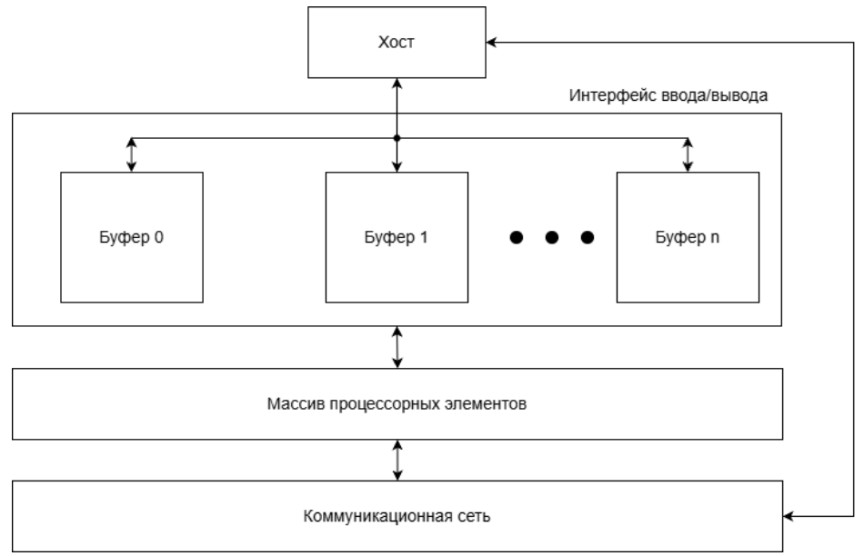
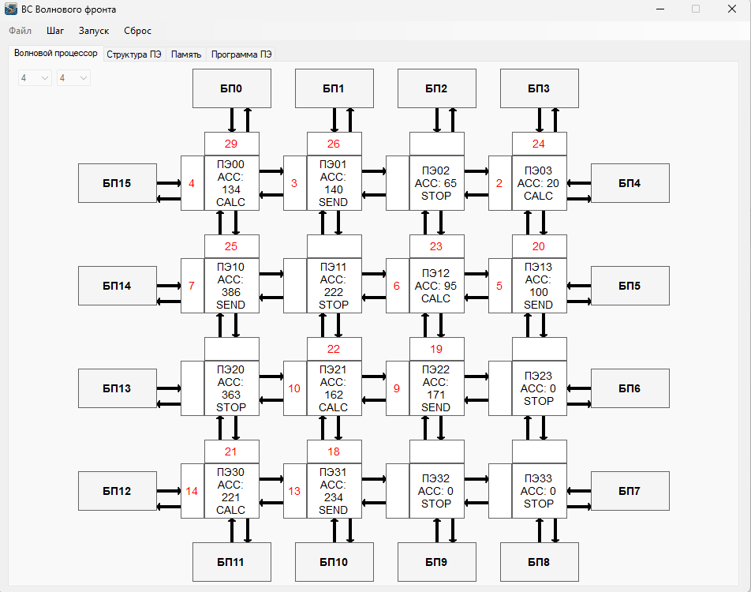
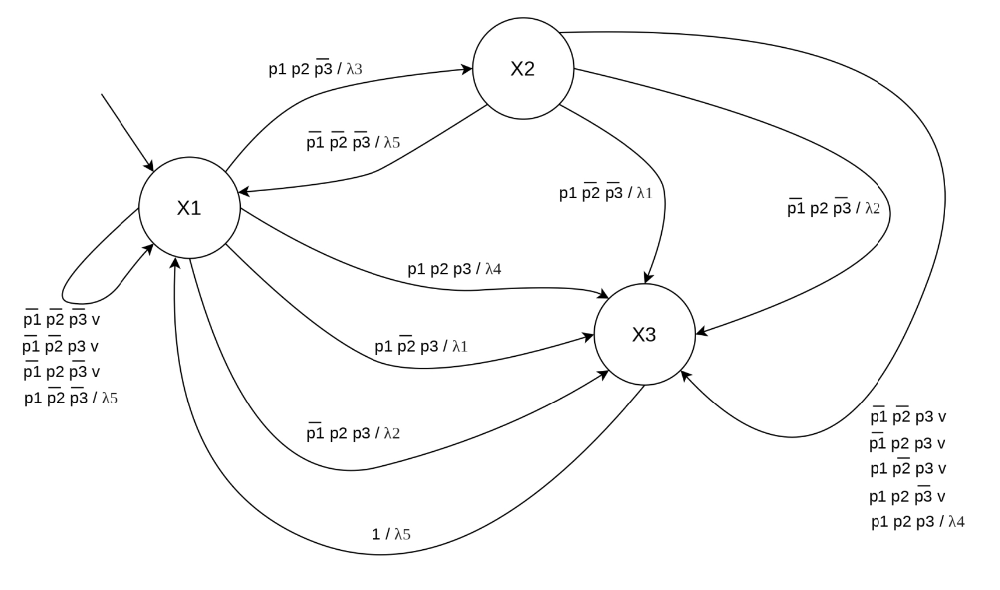
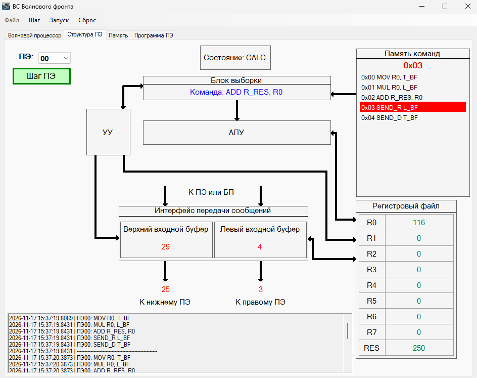
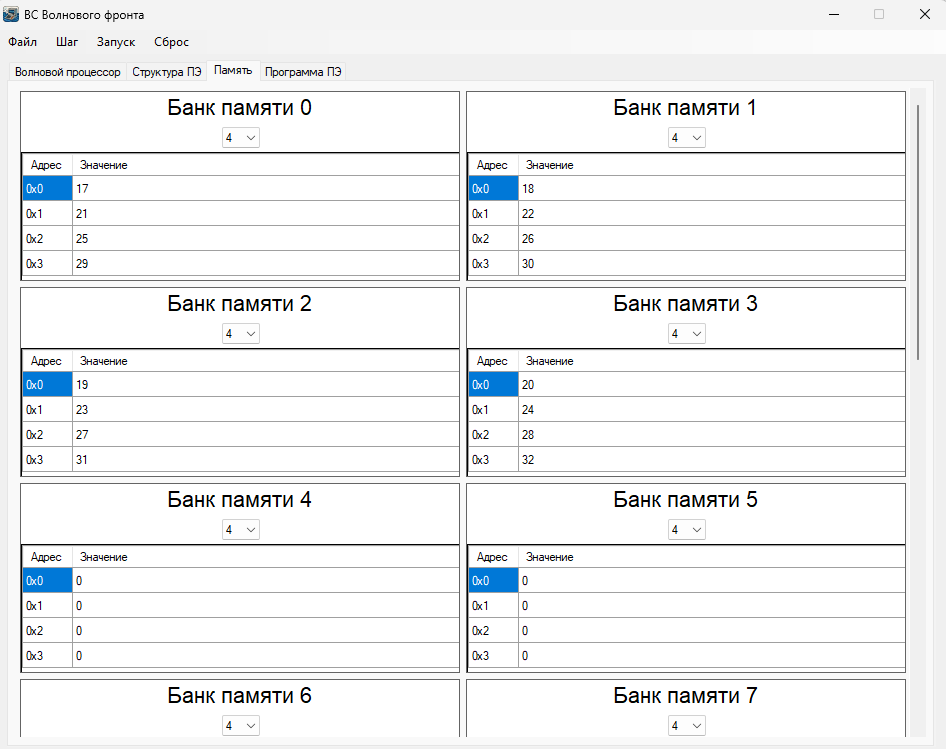
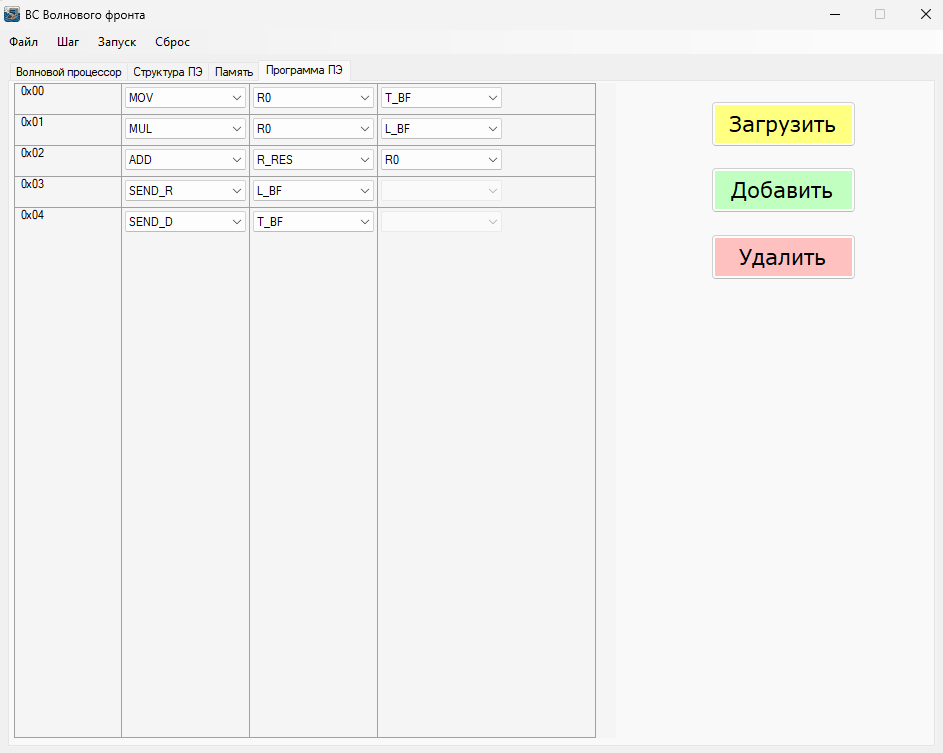

# Wavefront Array Processor Simulator
**[Регистрация компьютерной программы в Роспатенте](https://www.fips.ru/registers-doc-view/fips_servlet?DB=EVM&DocNumber=2026666162&TypeFile=html)**
## Зачем нужен проект

Матричные вычисления и обработка потоков данных требуют многократного выполнения однотипных операций. В таких задачах полезно распределять работу между множеством простых процессорных элементов и передавать промежуточные данные непосредственно между соседями. Это позволяет повторно использовать данные и сокращать обращения к общей памяти. Характерные задачи для таких массивов — умножение матриц, свёртки и цифровая обработка сигналов.

Вычислительные системы волнового фронта развивают идею систолических массивов: процессорный элемент начинает работу по готовности входных данных, без единого тактового сигнала для всего массива. Изучать такую архитектуру только по статическим схемам сложно. Этот **учебный симулятор на C# и Windows Forms** позволяет задать программу, проследить движение данных и разобраться, как локальные вычисления складываются в общий результат. Проект предназначен для практических и лабораторных занятий по организации ЭВМ и систем.

## Публикация и награда

Разработка представлена в статье **[«Разработка программного эмулятора фрагмента вычислительной системы волнового фронта»](https://elibrary.ru/item.asp?id=89204491)**.

Работа отмечена **наградой СибАК за лучшую работу по решению редакционной коллегии**.

## Как работает волновой фронт

Система состоит из хоста, интерфейса ввода/вывода, массива процессорных элементов (ПЭ) и сети их соединений. Данные проходят через соседние ПЭ, каждый из которых выполняет свою часть вычислений. Передача согласуется с готовностью получателя — по принципу «рукопожатия». Так вычисления продвигаются по массиву волной.



*Общая схема из проектной документации, рисунок 22.*

В симуляторе можно настроить массив от **1×1 до 4×4 ПЭ**. У каждого элемента есть верхний и левый входные буферы, регистры `R0–R7`, регистр результата `R_RES` и память команд. Данные поступают сверху и слева, сообщения передаются вправо и вниз. Банки памяти по периметру задают входные последовательности.

Работа ПЭ представлена тремя состояниями:

- `STOP` — ожидание входных данных;
- `CALC` — выполнение программы;
- `SEND` — передача сообщений соседям.

Это программная модель для изучения алгоритмов и обмена данными. Шаги и анимация показывают состояние системы, а не измеряют производительность физического процессорного массива.



## Автомат процессорного элемента

Поведение ПЭ описано **конечным автоматом Мили**: переход в следующее состояние и выходной сигнал зависят от текущего состояния и входных сигналов. В проектной документации эта модель выбрана потому, что требует трёх состояний, тогда как построенная эквивалентная модель Мура — пяти.



### Состояния

| На графе | В интерфейсе | Значение |
| --- | --- | --- |
| `X1` | `STOP` | Ожидание данных; начальное состояние ПЭ |
| `X2` | `CALC` | Выполнение загруженной программы |
| `X3` | `SEND` | Передача сообщений соседним ПЭ |

### Входные сигналы

| Сигнал | Значение `0` | Значение `1` |
| --- | --- | --- |
| `p1` | Левый входной буфер пуст | В левом буфере есть данные |
| `p2` | Верхний входной буфер пуст | В верхнем буфере есть данные |
| `p3` | Вычислительный режим | Режим ретрансляции сообщений |

Наличие данных не связано с их числовым значением: **ноль в буфере тоже считается данными**. Режим ретрансляции включается командой `SEND`: ПЭ передаёт содержимое левого буфера вправо, а верхнего — вниз, пропуская вычисления при последующем поступлении данных. **Сброс** возвращает вычислительный режим.

### Выходные сигналы

| Сигнал | Действие |
| --- | --- |
| `λ1` | Передача сообщения правому ПЭ |
| `λ2` | Передача сообщения нижнему ПЭ |
| `λ3` | Запуск вычислений |
| `λ4` | Передача сообщений одновременно правому и нижнему ПЭ |
| `λ5` | Остановка ПЭ и переход к ожиданию данных |

### Как читать граф

Подпись дуги имеет вид **«условие / выходной сигнал»**. Черта над `p` означает отрицание (`¬p`, значение `0`), запись сигналов подряд — логическое И, символ `∨` — логическое ИЛИ. `1` обозначает условие, истинное при любом наборе входных сигналов.

- `p1 p2 ¬p3 / λ3`: оба буфера заполнены, включён вычислительный режим — переход `STOP → CALC` с запуском программы.
- `p1 ¬p2 p3 / λ1`: в режиме ретрансляции заполнен только левый буфер — переход `STOP → SEND` для передачи вправо.
- `¬p1 p2 p3 / λ2`: в режиме ретрансляции заполнен только верхний буфер — переход `STOP → SEND` для передачи вниз.
- `p1 p2 p3 / λ4`: в режиме ретрансляции заполнены оба буфера — передача по обоим направлениям.
- `1 / λ5` на дуге `X3 → X1`: после этапа передачи ПЭ возвращается к ожиданию независимо от входной комбинации.

`STOP` у одного элемента означает ожидание, а не обязательно завершение вычислений всего массива. Граф описывает управляющую модель; сам обмен также учитывает готовность входного буфера соседнего ПЭ.

## Как запустить

Нужны **Windows**, **Visual Studio** с компонентами разработки классических приложений .NET и **.NET Framework 4.7.2 Targeting Pack**.

1. Клонируйте репозиторий и откройте `WavefrontArrayProcessorSimulator.sln`.
2. Восстановите NuGet-пакеты решения: `NLog` и `NLog.Windows.Forms`.
3. При необходимости назначьте `WavefrontArrayProcessorSimulator` запускаемым проектом.
4. Выберите `Debug` или `Release`, соберите решение и нажмите **Ctrl+F5** для запуска без отладки либо **F5** для запуска с отладчиком.

После сборки исполняемый файл находится в:

```text
src/WavefrontArrayProcessorSimulator/bin/Release/WaveVS.exe
```

Для конфигурации `Debug` замените `Release` на `Debug`. При переносе собранного приложения копируйте весь каталог сборки вместе с DLL и папкой `img`.

## Первый запуск с готовой конфигурацией

В папке **[readyTasks](readyTasks/)** находятся готовые конфигурации `.shizotex`: размер массива, программа ПЭ и данные банков памяти.

| Файл | Пример |
| --- | --- |
| `ADD_4x4.shizotex` | Сложение матриц |
| `SUB_4x4.shizotex` | Вычитание матриц |
| `MUL_4x4.shizotex` | Умножение матриц |
| `MUL_2x2_test.shizotex` | Тест умножения для массива 2×2 |
| `(a add b)div(c mul d).shizotex` | Выражение `(a + b) / (c × d)` |

Откройте файл через **Файл → Открыть**. Используйте **Шаг**, чтобы наблюдать изменения всего массива, или **Запуск**, чтобы выполнить вычисления автоматически. На вкладке **Структура ПЭ** выберите элемент и следите за его регистрами, буферами, текущей командой и журналом. Кнопка **Шаг ПЭ** выполняет отдельную команду, когда элемент находится в состоянии `CALC`. **Сброс** возвращает систему к исходному состоянию вычислений.

## Своя программа

1. На вкладке **Волновой процессор** выберите размер массива.
2. На вкладке **Память** задайте длины очередей банков и значения ячеек. Данные считываются начиная с адреса `0x0`; порядок подачи должен соответствовать выбранному алгоритму. Десятичный разделитель зависит от региональных настроек Windows.
3. На вкладке **Программа ПЭ** составьте программу из выпадающих списков. **Добавить** и **Удалить** изменяют конец программы; **Загрузить** применяет программу ко всем ПЭ.
4. Выполните вычисления пошагово, проверьте результат и сохраните конфигурацию через **Файл → Сохранить как**.

Например, эта программа накапливает произведения пар входных значений в `R_RES` и передаёт исходные значения дальше по массиву:

```asm
MOV    R0, T_BF
MUL    R0, L_BF
ADD    R_RES, R0
SEND_R L_BF
SEND_D T_BF
```

Здесь `T_BF` — верхний входной буфер, `L_BF` — левый. Один цикл вычислений добавляет к результату произведение: `R_RES ← R_RES + T_BF × L_BF`. Для матричного умножения важна также согласованная подача входных последовательностей — её можно изучить на примерах из `readyTasks`.

## Система команд

Все ПЭ получают одну программу, но работают со своими регистрами и входными данными. Команды выполняются последовательно. Программа содержит от **1 до 15 строк**; для просмотра отдельной инструкции используйте **Шаг ПЭ** в состоянии `CALC`.

### Операнды и форматы

| Обозначение | Назначение |
| --- | --- |
| `R0–R7` | Восемь регистров общего назначения |
| `R_RES` | Регистр результата, отображаемый также как `RES` или `ACC` |
| `L_BF` | Левый входной буфер |
| `T_BF` | Верхний входной буфер |

В обозначениях ниже `Rd` — регистр назначения (`R0–R7` или `R_RES`), `S` — регистр либо входной буфер. **Первый операнд двухадресной команды — место записи результата**, второй — источник данных. Буферы доступны программе только для чтения: записать в `L_BF` или `T_BF` обычной командой `MOV` нельзя.

Поддерживаются три формата:

- **Двухадресный:** `КОМАНДА Rd, S`; способы адресации «регистр — регистр» и «регистр — буфер».
- **Одноадресный:** `SEND_R S`, `SEND_D S`; источник — регистр или буфер.
- **Без операндов:** `SEND`, `WRITE_BUFF`.

### Арифметика и копирование

| Команда | Действие | Пример |
| --- | --- | --- |
| `MOV Rd, S` | `Rd ← S`; источник сохраняется | `MOV R0, T_BF` — прочитать верхний буфер в `R0` |
| `ADD Rd, S` | `Rd ← Rd + S` | `ADD R_RES, R0` — прибавить `R0` к результату |
| `SUB Rd, S` | `Rd ← Rd − S` | `SUB R0, L_BF` — вычесть левый вход из `R0` |
| `MUL Rd, S` | `Rd ← Rd × S` | `MUL R0, L_BF` — умножить `R0` на левый вход |
| `DIV Rd, S` | `Rd ← Rd / S` | `DIV R0, R1` — разделить `R0` на `R1` |

Значения обрабатываются как числа с плавающей точкой одинарной точности (`float`). Арифметические команды изменяют только регистр назначения. Чтение входного буфера само по себе не удаляет его содержимое.

### Передача и обновление данных

| Команда | Действие | Пример |
| --- | --- | --- |
| `SEND_R S` | Выбирает значение сообщения правому соседу | `SEND_R L_BF` — передать вправо значение левого буфера |
| `SEND_D S` | Выбирает значение сообщения нижнему соседу | `SEND_D T_BF` — передать вниз значение верхнего буфера |
| `SEND` | Включает режим ретрансляции: левый вход направляется вправо, верхний — вниз | `SEND` |
| `WRITE_BUFF` | Принудительно обновляет оба входных буфера | `WRITE_BUFF` |

`SEND_R` и `SEND_D` задают сообщения во время выполнения программы; непосредственно передача происходит на этапе `SEND`. Команда `SEND` переключает режим работы ПЭ, а не завершает текущую программу: следующие за ней инструкции текущего выполнения также будут исполнены.

У `WRITE_BUFF` есть важная особенность: если соответствующий вход подключён к внешнему банку памяти, команда считывает следующий элемент непустой очереди и перезаписывает буфер. Если на этом входе находится соседний ПЭ, буфер очищается для приёма нового сообщения. При пустой очереди банка прежнее содержимое буфера сохраняется. Поэтому `WRITE_BUFF` следует применять осознанно: команда может заменить ещё не использованные данные.

### Формат команды в проектной модели

В PDF описано фиксированное **16-битное слово команды**: четыре поля по четыре бита — код операции, способ адресации и два адреса операндов. Одноадресные команды и команды без операндов выравниваются до общей длины; при выборе размера полей предусмотрен резерв для расширения системы команд. В интерфейсе симулятора программа задаётся мнемониками и выбором операндов.

## Экранные формы

### Структура процессорного элемента

Текущая команда, входные буферы, регистровый файл, исходящие сообщения и журнал выполнения.



### Память

Редактирование входных данных и количества ячеек в каждом банке.



### Программа ПЭ

Выбор команд и операндов, добавление и удаление строк, загрузка программы в массив.


